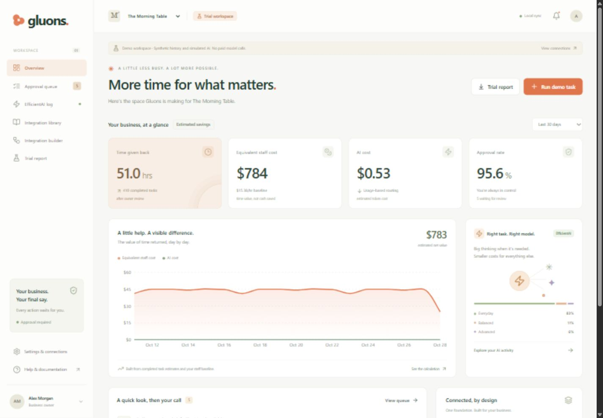

# gluons.

**Reusable AI operations for small businesses. Expert-built foundations, owner-approved actions, and lower-cost intelligence.**

[](https://github.com/kowstav/gluons/actions/workflows/ci.yml)

Gluons is a working Next.js prototype with a persistent, no-key demo and configurable live service adapters. It makes the three-layer integration model visible:



**Core components + sector pack + business setup = one integration.**

## Run locally

Requires Node.js 22+ and npm. No paid account or API key is needed for the demo.

```sh
git clone https://github.com/kowstav/gluons.git
cd gluons
npm ci
npm run dev
```

Open [the landing page](http://127.0.0.1:3000) or [the dashboard](http://127.0.0.1:3000/dashboard). The landing page includes a captioned 30-second walkthrough made from the real browser acceptance screenshots; it has no narration or external tracking.

The sample food business has 432 clearly labeled synthetic historical tasks. New tasks, approvals, settings, integrations, and trial requests persist in `apps/dashboard/.data/workspace.json`. Demo AI is deterministic and does not call a paid model. The local demo is a single-owner workspace on loopback.

You can also open this repository in GitHub Codespaces using the included dev container. Codespaces is user-initiated and may have account charges; the prototype does not provision one automatically.

## What works

- **Savings overview:** estimated net staff hours, equivalent time value, AI cost, approval rate, date filtering, and daily chart.
- **Approval queue:** automatic refresh, search, approve, reject, edit notes, change order quantity with trusted repricing, change ledger amount, and an audit record of original content and reviewer identity.
- **EfficientAI log:** typed task difficulty and special-attention decisions, cheap/medium/frontier selection, schema and business-fact checks, bounded escalation, all model attempts and estimated token costs. Demo decisions are labeled as simulations of Jev.
- **Integration library:** six versioned core components and food-vendor/retail packs. “Used by N businesses” comes from saved integrations.
- **Integration builder:** sector selection, component toggles, business details, catalog, stock thresholds, per-item ingredient/SKU consumption mapping, baseline costs, review, and trial deployment. Newly created businesses start with an empty task history.
- **Trial report:** before/after comparison, review-time allowance, separate trial/live outcome counts, transparent assumptions and a downloadable multipage PDF.
- **Landing page:** working demo link, captioned demo walkthrough and a durable free-trial request form. Requests are saved; the prototype does not send email or schedule appointments.
- **Agent Skills export:** six `SKILL.md` folders with component definitions and prompts.
- **Live adapter code:** Supabase auth, owner-scoped storage, transactional projections and Realtime; AI SDK 7 + Jev/Gateway; authenticated Vapi intake; signed Twilio WhatsApp intake and owner-approved delivery; scheduled daily reports and low-stock alerts; Langfuse ingestion.

Live service credentials, a purchased telephone number, provider account setup, hosting and domain ownership are **not included**. Those services have not been exercised against a real account in this build. See [setup](docs/SETUP.md) for the exact configuration.

## Demo walkthrough

1. Open the overview and click **Run demo task**.
2. Leave **Order taker** selected; enable the failed-check escalation example.
3. Route the task. The invalid cheap output escalates to a stronger model.
4. Review the staged order. Edit its quantity or pickup note, then approve it.
5. In trial mode, it becomes **simulated**: no order, stock deduction, message or expense operation is performed.
6. Open **EfficientAI log** and inspect both model attempts.
7. Build a second business using the same library. Reuse counts update from one business to two.
8. Export its **Trial report** as a PDF.

For local live-operation testing, switch a business to Live in Settings, stage a new order, and approve it. Gluons appends a local operation record and deducts the configured ingredient quantities exactly once. This is Gluons' internal operations ledger; no POS, supplier ordering, bank or accounting vendor is connected. Real WhatsApp delivery additionally requires `LIVE_ACTIONS_ENABLED=true` and Twilio credentials.

## Repository

```text
apps/dashboard/              Next.js + TypeScript + Tailwind UI and route handlers
packages/runtime/            Routing, checks, staging, execution, seed, savings
packages/components/         Six independent definitions, prompts, handlers, tests
packages/sector-packs/       Food-vendor and retail-shop rules
skills/                      Exported Agent Skills
supabase/                    Migration, catalog seed, local configuration
scripts/                     Skills export and isolated HTTP verification
tests/                       End-to-end HTTP workflow tests
docs/                        Setup, architecture, acceptance and constraints
```

The UI uses shadcn-style source primitives, Recharts, Lucide icons and Framer Motion. Server and browser runtime exports are separated so the execution engine cannot leak into the browser bundle.

## Validate

```sh
npm run skills:export
npm run check
```

`check` runs TypeScript, component/runtime/Postgres tests, a production build, and isolated end-to-end HTTP tests against that production build. `npm run test:e2e` runs the HTTP tests against an already running server. Browser acceptance checks are documented separately; they are not disguised as API tests. No browser installation is required by CI.

For a local production preview:

```sh
npm run build
# Set GLUONS_ALLOW_LOCAL_DEMO=true in apps/dashboard/.env.local
npm start
```

## Human control and cost accounting

`pending → approved → simulated` in trial mode; `pending → approved → executed` for local live operations. Rejected actions never run. External delivery claims `executing` before a network call. An uncertain outcome becomes `execution_unknown`; it is not automatically retried. Approval records include identity and timestamp. Pending actions retain the operating mode captured at staging.

Estimated time returned = `max(0, completed task minutes − review minutes for all decisions) / 60`. Pending and rejected tasks earn no gross savings. Failed tasks and unsuccessful completed model attempts still contribute their known model cost. Unknown usage after a provider failure is explicitly marked and not invented. Equivalent staff cost is the value of staff time, **not realized payroll or cash savings**. Voice, messaging, hosting, taxes and subscription fees are excluded.

Default USD/1M token rates are a 2026-10-28 snapshot, not a price guarantee: [Haiku 5.5](https://vercel.com/ai-gateway/models/claude-haiku-5.5), [Sonnet 5.5](https://vercel.com/ai-gateway/models/claude-sonnet-5.5), [Opus 5.5](https://vercel.com/ai-gateway/models/claude-opus-5.5). Jev's configured input rate is an estimate; verify the current price in your Gateway account. All rates and working model IDs can be overridden. Jev uses the [AI SDK typed decisions API](https://ai-sdk.dev/docs/ai-sdk-core/decisions), not a chat completion.

Sector expert names are explicitly marked as reference personas with validation pending. No real expert endorsement is claimed.

See [architecture and prototype limits](docs/ARCHITECTURE.md), [setup](docs/SETUP.md), and the [implementation tracker](TASKS.md).

MIT licensed.
