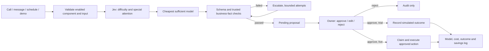

# Runtime and data flow

## Modules

`packages/components/<id>` holds a versioned JSON definition, prompt, trusted handler and tests. The handler produces the executable arguments allowed for that component. Generation can improve the explanatory summary and details; it cannot invent prices, stock facts, recipients or action kinds. Owner edits are separately validated and retain the original proposal. Quantity edits reprice from the catalog and check ingredient availability.

Sector packs declare their component set and domain rules. The builder creates an integration with component version pins, a business catalog and inventory, per-sale stock consumption, and the staff baseline. The included packs are reference implementations awaiting real sector-expert validation.

`packages/runtime/src/client.ts` exports browser-safe catalog, seed and savings utilities. Execution code remains in the server entry point. `apps/dashboard/src/lib/server` contains storage and service adapters; Next route handlers validate inputs and authenticate the owner before invoking them.

## Storage and concurrency

The local adapter serializes mutations in one Node process and atomically renames a complete snapshot. Use it only for a local, single-process demo. HTTP tests use their own separate data file, never the user's current demo data.

The Supabase adapter uses an owner-scoped workspace snapshot with a revision number. `save_workspace` locks the workspace row, checks the expected revision, writes the snapshot and refreshes normalized `businesses`, `integrations`, `tasks`, `proposed_actions`, `baselines`, audit and effects projections in one transaction. It also appends `savings_snapshots`. Definitions live in `components` and `sector_packs`. RLS prevents cross-owner reads; direct mutations are revoked. The privileged RPC also explicitly checks the authenticated owner's identity. Realtime listens to the snapshot commit so the screen refreshes consistently.

This snapshot approach keeps the prototype understandable and makes approval and local effects atomic. It rewrites projections and downloads the whole workspace; it is not intended for large histories. Before production scale, move task processing to a durable job queue and individual SQL transactions. Concurrent distributed AI calls can spend tokens before one loses a revision race; avoid high-concurrency ingestion until a job claim/outbox worker is implemented. A 409 is surfaced to the caller rather than silently overwriting another owner's decision.

## State and execution

- Trial: pending → approved → simulated.
- Local live: pending → approved → executed, with a unique operation effect.
- Rejection: pending → rejected, no execution.
- External WhatsApp: pending → approved → executing → executed or execution_unknown.

Inbound provider IDs are scoped per business. Already executed or simulated local actions return their existing outcome. Other reviewed decisions cannot be approved twice. Stock is checked at staging and again immediately before a local live order is committed. An edited proposal stores original content and data.

External delivery cannot promise exactly-once behavior across a network failure. Gluons claims the action before calling Twilio and blocks automatic retry if the outcome is uncertain. An operator must reconcile that outcome with Twilio. A failure to persist the final delivery result may leave an `executing` claim; it must also be reconciled manually. Local operations are internal Gluons records, not a POS, banking or accounting integration.

## Costs and estimates

Jev and working-model attempts are tracked separately. Completed attempts use token usage and configurable rates; demo usage is synthetic. A transport error is logged as unknown usage, not assumed to be free. Decision failure fails closed with no staged action. All successful outputs still need owner approval.

Potential time savings are recognized only for executed or simulated actions. Rejected and pending actions contribute no gross time savings. Every reviewed proposal contributes an estimated review allowance. Costs include all known AI usage for the selected date range. Equivalent staff time is an opportunity-cost estimate, not an assertion of reduced payroll. Dates in historical fixtures are generated relative to the current date.

## Boundaries before a public pilot

The code and local demo are complete as a prototype. Live Supabase/Gateway/voice/messaging/Langfuse account integration, domain DNS, real expert validation and pilot measurement remain account- or human-dependent. Public trial submissions need durable rate limiting and anti-bot controls for launch. There is no billing system, calendar scheduling service, real POS, automated supplier purchasing, or production job worker. These limits are stated in the UI and setup guide where relevant.
